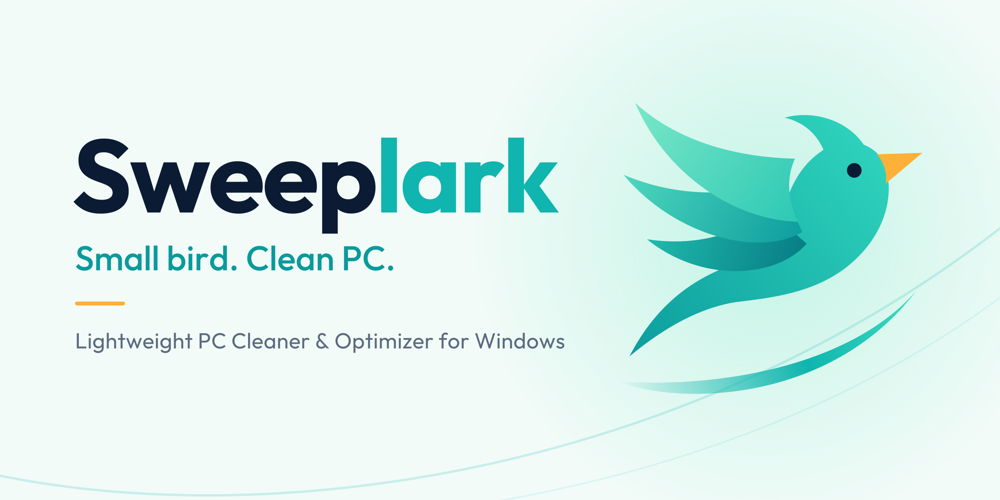

<p align="center">
  
</p>

<p align="center">
  <b>A lightweight PC cleaner, optimizer and health monitor for Windows — with an offline AI assistant.</b><br>
  Safe work happens by itself, risky work asks first, and every change is recorded.
</p>

<p align="center">
  
  
  
  
</p>

---

## Download

Get the latest version from **[Releases](../../releases)**:

| File | For |
|---|---|
| `Sweeplark-x.y.z-Setup.exe` | **Recommended.** ~4 MB installer, no admin needed. Starts with Windows in the tray. Data in `%LOCALAPPDATA%\Sweeplark`, settings in `%APPDATA%\Sweeplark`. |
| `Sweeplark-x.y.z-Portable.exe` | Single exe, no install. Keeps everything in a `SweeplarkData` folder next to it. Needs the Microsoft Edge WebView2 Runtime (built into Windows 11). |

The app checks GitHub for new versions at startup and asks before updating.
Not code-signed yet: if SmartScreen appears, click **More info → Run anyway**.

## Why Sweeplark

| | |
|---|---|
| 🪶 **Light** | ~8 MB app, Rust core, no background services. Closing the window frees its memory; the tray reads stats only while you hover it. |
| 🛡️ **Safe by design** | Preview before every action, personal folders are never touched, files that look like *your* data always need your tick. |
| 🧾 **Honest** | Every change goes into a ledger. Startup changes can be undone. No fake "RAM boost", no registry cleaner. |
| 🤖 **Offline AI** | A small local model (Lite / Balanced / High) explains your PC, writes daily reports and double-checks unclear files. Loaded only for seconds, then unloaded. |
| 🌐 **English & Hinglish** | English by default; Hinglish can be picked in Settings. |
| 🚫 **No tracking** | No ads, no account, no telemetry. |

## Features (v1.4.1)

What changed in each version: see [CHANGELOG.md](CHANGELOG.md).

- **Boost** — one click, you choose: free RAM from background apps, deep RAM clean (admin: modified + standby lists, like RAMMap), Efficiency mode for CPU/GPU-heavy background apps, fastest power plan. The app you were using, voice chat, streaming, anti-cheat, security tools and your own "never touch" list are left alone. **Put back** undoes it.
- **Game mode & RAM guard** (optional) — calm background apps while a game is full screen; free RAM by itself when memory stays nearly full.
- **Optimizer** — 100+ Windows tweaks with one-click *Apply recommended*, an off switch for every one, and a restore point first: performance, gaming, GPU driver tweaks for NVIDIA / AMD / Intel, power, privacy, Windows AI (Recall, Copilot, Edge/Paint/Notepad AI), services, Explorer, taskbar and system.
- **One-Click Optimize** — scan junk, startup, storage, health and security; fix only the safe part; report what changed.
- **Cleaner** — 45+ rules for Windows, browsers, apps, games, GPU shader caches and developer tools, with an approval gate for anything that looks like your files (those go to the Recycle Bin).
- **Storage** — biggest folders and files, space by file type, and an exact **duplicate finder**; removing always goes to the Recycle Bin.
- **Apps** — uninstall programs and clean their leftover folders; app updates through winget.
- **Monitor** — live CPU (per core, clock), GPU usage / VRAM (all vendors) and temperature (NVIDIA), memory, network and disk speed; process list with Eco and End (asks first). CPU temperature is read from LibreHardwareMonitor when it runs (Windows has no reliable API of its own).
- **Startup manager** — Run keys, Startup folders and sign-in scheduled tasks; on/off with advice and undo.
- **Health** — disks and disk health, battery wear, Defender and firewall status.
- **Tools** — SFC, DISM, update cleanup, disk check, Windows Update repair, restore point, Explorer restart, icon cache rebuild, DNS flush, network reset, power plans, shutdown timer, hardware details and shortcuts to Windows tools.
- **Background jobs** — long tasks keep running when you switch pages, with progress, time left and tips.
- **Tray** — starts with Windows; hover shows CPU/GPU usage and temperature, RAM and free disk; quick Boost.
- **Background agent** — smart alerts, scheduled auto-clean with approval, daily and weekly reports.
- **Offline AI assistant** — answers from measured facts (performance, graphics, background apps, storage, startup, Optimizer, installed apps, security) and offers buttons to act; three model sizes.
- **Updates** — checks GitHub Releases at startup and asks before updating. **Report a problem** opens a prefilled GitHub issue.

## How the approval gate works

1. Auto-clean scans with the same rules as manual cleaning.
2. Files the rules are unsure about can get an AI second opinion. **The AI can only make things safer** — it can mark a file risky, never clear a file the rules see as yours.
3. Default mode **Ask always**: nothing is deleted until you approve (notification with a sound). Optional mode **Risky only**: cache/temp is cleaned automatically, the rest waits for you.

More in [`docs/SAFETY.md`](docs/SAFETY.md).

## Offline AI

| Tier | Model | Download | For |
|---|---|---|---|
| Lite | Qwen3.5 0.8B | 533 MB | 4–6 GB RAM |
| Balanced | Qwen3.5 2B | 1.28 GB | 8 GB RAM |
| High | Qwen3.5 4B | 2.74 GB | 16 GB RAM or a graphics card |

Runs on [llama.cpp](https://github.com/ggml-org/llama.cpp). Models are pinned and SHA-256 verified. Small models don't need tool calling: the app picks and runs the tools, the model only reads short facts, and a guard rejects made-up numbers. Details in [`docs/AI.md`](docs/AI.md).

## Project layout

```
crates/sweeplark-core   Rust engine: cleaner, startup, health, ledger, agent, AI
crates/sweeplark-cli    `sweeplark` command line
app/                    Desktop app: Tauri 2 (Rust) + Svelte 5 UI
rules/                  Cleaner rules, startup advice, AI model catalog (TOML data)
assets/brand            Logo, icon and brand kit
docs/                   Safety, AI and rule-format docs
```

## Build

Requirements: Windows 10/11, Rust (stable), Node.js 22.

```bash
cd app
npm ci
npx tauri build
```

The installer is written to `target/release/bundle/nsis/`. CI builds it on every push (`.github/workflows/ci.yml`).

Run the core tests (any OS):

```bash
cargo test
```

## Developer

Made by **[Kartik Langwan](https://kartiklangwan.runs-on.dev)** — independent developer, Delhi, India.
I make websites, tools, apps and Discord bots that feel good to use.

## Credits

Optimizer tweak values follow Microsoft documentation and the open-source
[optimizerDuck](https://github.com/itsfatduck/optimizerDuck) project (GPL-3.0).

## License

GPL-3.0-or-later. See [LICENSE](LICENSE).
